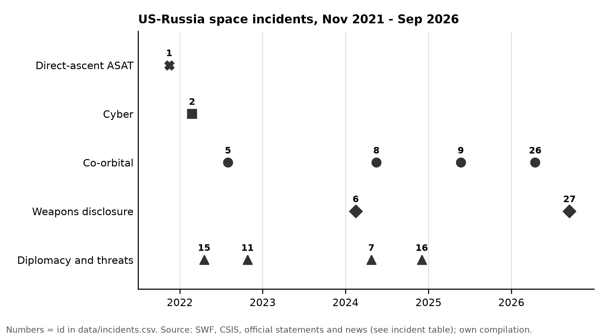

# Findings – USA vs Russia Satellite Tracking

Data: Space-Track.org SATCAT (retrieved 2026-11-18; Kosmos 1408 debris in RQ3 retrieved 2026-11-04) and GCAT by J. McDowell (version 2026-11-18); own analysis.
Period: payloads launched **24 Feb 2022 – 30 Sep 2026**, including 26 small satellites deployed from the ISS (launch date = their cargo flight). 2022 is a partial year (from 24 Feb), 2026 covers January–September.
All tables are generated by `src/03_charts.py`, `src/04_debris.py` and `src/05_incidents.py` (CSV versions in `output/tables/`).
Classification systems and how we map them: [METHODOLOGY.md](../METHODOLOGY.md). Incident research for RQ3/RQ4: [METHODOLOGY_INCIDENTS.md](../METHODOLOGY_INCIDENTS.md).

---

## RQ1 – How many satellites were launched and what are they for?

### Table 1: Launches and payloads by category

|  | USA | USA excl. Starlink | Russia |
|---|---:|---:|---:|
| Orbital launches | 588 | 209 | 84 |
| **Payloads total** | **12 533** | **1 720** | **185** |
| Military | 514 | 514 | 71 |
| Civil | 99 | 99 | 63 |
| Commercial | 1 095 | 1 095 | 49 |
| Starlink | 10 813 | – | – |
| Unknown | 12 | 12 | 2 |

*Orbital launches = distinct launches carrying at least one payload of the country (regardless of the rocket's country).*

### Table 2: Payloads per year

| Country | Category | 2022* | 2023 | 2024 | 2025 | 2026** | Total |
|---|---|---:|---:|---:|---:|---:|---:|
| USA | Military | 33 | 43 | 127 | 149 | 162 | 514 |
| USA | Civil | 22 | 16 | 21 | 25 | 15 | 99 |
| USA | Commercial | 95 | 186 | 125 | 365 | 324 | 1 095 |
| USA | Starlink | 1 529 | 1 984 | 1 964 | 3 169 | 2 167 | 10 813 |
| Russia | Military | 15 | 10 | 5 | 20 | 21 | 71 |
| Russia | Civil | 9 | 11 | 27 | 10 | 6 | 63 |
| Russia | Commercial | 3 | 0 | 10 | 4 | 32 | 49 |

*\* from 24 Feb 2022, \*\* until 30 Sep 2026. Unknown category omitted (14 payloads).*

### Table 3: Military satellites by mission type

| Mission (GCAT category) | USA | Russia |
|---|---:|---:|
| Imaging / reconnaissance | 244 | 32 |
| Communications | 74 | 17 |
| Technology demonstration | 44 | 7 |
| Missile early warning | 23 | 1 |
| Signals intelligence | 11 | 7 |
| Navigation | 6 | 6 |
| Not yet in GCAT / other | 112 | 1 |
| **Total** | **514** | **71** |

*"Not yet in GCAT" = mostly US military satellites launched after GCAT's coverage ends (~July 2026); their mission is not unknown, just not yet catalogued.*

### What it shows

- **The USA launched about 68× more payloads than Russia (12 533 vs 185).** The gap is driven by Starlink
  (86 % of all US payloads), but even without Starlink the USA launched **9× more** payloads than Russia.
- **Almost all payloads can be assigned an operator category from open sources:** only 14 of 12 718 (0.1 %) remain unknown (99.3 % classified without Starlink).
  Classification relies on catalogue names (e.g. `USA xxx`, `COSMOS xxxx`) and McDowell's GCAT, not on orbital data alone; name rules assign a category, they do not prove a satellite's purpose.
- **US military launches grew roughly five-fold** from 33 (2022) to 162 (Jan–Sep 2026). The growth is in large LEO
  constellations (names `USA xxx` and `PRAETORIAN SDA`, i.e. Space Development Agency satellites).
- **Russia's military launch rate stayed low** (5–21 per year), with a dip in 2024 and a recovery in 2025–2026.
  Russia's 2026 commercial jump (32) is the start of the RASSVET broadband constellation (Bureau 1440).
- **Imaging / reconnaissance is the most common military mission for both countries** (about half of military payloads).
  The USA has a much larger missile early-warning segment (23 vs 1).

---

## RQ2 – Hypothesis H1: Both the USA and Russia focus on LEO

### Table 4: Orbital regimes (share of payloads)

| Group | n | LEO | MEO | HEO | GEO | Unknown |
|---|---:|---:|---:|---:|---:|---:|
| USA | 12 533 | 99.2 % | 0.1 % | 0.1 % | 0.5 % | 0.2 % |
| USA excl. Starlink | 1 720 | 94.4 % | 0.4 % | 0.6 % | 3.3 % | 1.3 % |
| Russia | 185 | 88.1 % | 6.5 % | 2.7 % | 2.2 % | 0.5 % |
| US military | 514 | 90.5 % | 1.4 % | 0.0 % | 6.8 % | 1.4 % |
| Russian military | 71 | 80.3 % | 11.3 % | 5.6 % | 2.8 % | 0.0 % |

*LEO = apogee below 2 000 km; HEO = eccentricity above 0.25; GEO = period 1 400–1 460 min and eccentricity below 0.05; MEO = rest. Based on each satellite's current or last known orbit. Shares are taken over all payloads in the group, including those with unknown orbit (conservative).*

### Table 4b: Second source – Space-Track vs GCAT

| Group | n | LEO % Space-Track | LEO % GCAT | Both known | Regime differs | Unknown in GCAT |
|---|---:|---:|---:|---:|---:|---:|
| USA | 12 533 | 99.2 % | 94.5 % | 11 902 | 8 | 626 |
| USA excl. Starlink | 1 720 | 94.4 % | 87.3 % | 1 561 | 8 | 154 |
| Russia | 185 | 88.1 % | 79.5 % | 164 | 4 | 21 |
| US military | 514 | 90.5 % | 70.0 % | 397 | 2 | 113 |
| Russian military | 71 | 80.3 % | 80.3 % | 70 | 1 | 1 |

*Orbit regime from GCAT = J. McDowell's own orbit class (`OpOrbit`), compiled independently from Space-Track.
"Both known" = satellites with a known regime in both sources; "Regime differs" counts only those.*

### What it shows

- **H1 is tested on two independent catalogues** (Space-Track and GCAT) and holds in both. The lowest GCAT
  share is 70 % (US military).
- **Where both sources know the orbit, they almost always agree:** the regime differs for only 12 of 12 066
  payloads (0.1 %). GCAT shares are lower only because GCAT has no orbit yet for recent launches
  (mostly US military satellites from after ~July 2026), which are counted as unknown (conservative).
- **H1 is confirmed, including for military satellites.** Tested groups: USA excl. Starlink, Russia, US military and
  Russian military; H1 holds if every group has more than 50 % in LEO. The lowest share is 80 % (Russian military).
- **Russia uses MEO and HEO more than the USA.** MEO = GLONASS navigation satellites, HEO = highly elliptical
  orbits inclined at ~63° (visible in Figure 3), typical of Russian early-warning and communication systems
  that cover the northern hemisphere.
- **The US military keeps a GEO segment (6.8 %)** in addition to its LEO constellations.
- 7 US military satellites (`USA xxx`) have **no published orbital data** – an inherent limit of open-source tracking.

---

## RQ3 – Were there documented attacks on satellites, and what were their consequences?

**Method in brief** (identical to Section 4.3 of the team report incl. the tracked additions of 23 Nov 2026; see `report/RQ3_RQ4.md`): an **attack** is any deliberate
action intended to destroy, damage, disable or interfere with a satellite, its signals, or its ground and user equipment.
Incidents are sorted into the five SWF categories (co-orbital, direct-ascent, electronic warfare, directed energy, cyber)
and given an **evidence level**: *confirmed* (admitted by the actor, or formally attributed by several governments with
supporting technical data), *attributed* (named by a government without public technical evidence) or *claimed or
suspected* (reported only by the victim, the media or a hacker group).

### Table 5: Documented attacks and counterspace activities, 2021–2026

| Date | Incident | Category | Actor; evidence | Main consequences |
|---|---|---|---|---|
| 15 Nov 2021 | Ground-launched missile destroys the inactive Russian satellite Kosmos 1408 | Direct-ascent (kinetic) | Russia; confirmed (Russian MoD, US government) | 1 806 catalogued debris pieces; ISS crew shelters; US test moratorium; UNGA resolution 77/41 |
| 24 Feb 2022 | AcidRain wiper malware disables modems of the Viasat KA-SAT network | Cyber | Russia; confirmed (EU, UK and US attribution, May 2022) | Outages in Ukraine and Europe; 5 800 German wind turbines lose remote access; almost 30 000 routers replaced |
| 2022–2026 | Jamming and spoofing of GPS signals in Ukraine and, since late 2023, over the Baltic | Electronic warfare | Russia; attributed (European governments; ICAO, October 2025) | Less accurate US-supplied weapons (JDAM, HIMARS); thousands of aviation interference cases per month; flight suspensions |
| 2022–2026 | Jamming of Starlink terminals used by Ukrainian forces (e.g. Volna Kupol Garant) | Electronic warfare | Russia; claimed (Ukrainian officials) | Local, temporary outages; in 2022 countered quickly by SpaceX software updates |
| Aug 2022 – May 2025 | Kosmos 2558, 2576 and 2588 placed in the orbital planes of US reconnaissance satellites | Co-orbital | Russia; attributed (US Space Command) | No damage; US calls the satellites counterspace weapons |
| Jun 2023 | Cyberattack on Dozor-Teleport, a Russian satellite internet provider serving the FSB and the military | Cyber | Hackers claiming Wagner affiliation; claimed | Ground infrastructure and user terminals damaged; service offline |
| 2024 | Jamming and hijacking of European and Ukrainian TV broadcasting satellites | Electronic warfare | Russia; attributed (Swedish and French authorities via the ITU) | Interrupted programmes; Russian war footage shown on Ukrainian TV; ITU: “extremely worrisome and unacceptable” |
| 2025 | Jamming of UK satellites and of the German military; Luch/Olymp satellites track Intelsat satellites in GEO | Electronic warfare, co-orbital | Russia; attributed (UK and German defence officials) | No lasting damage; Germany plans €35 bn for space programmes |
| 16–18 Oct 2026 | Kosmos 2612 approaches the US-registered commercial radar satellite ICEYE-X36 | Co-orbital | Russia; attributed (US at the UN; COMSPOC and LeoLabs data) | No damage reported; debate on protecting commercial satellites |

*Own compilation based on the sources cited in Section 4.3 of `report/RQ3_RQ4.md`. Records in `data/incidents.csv`:
ids 1, 2, 4, 3, 5/8/9, 21, 22, 20/29 and 26.*

### What it shows

- **The only destructive event in the period was the Russian test against its own satellite** in November 2021;
  no satellite of another country was destroyed or physically damaged in the open record.
- **All hostile actions against other countries' space systems were non-destructive:** jamming, cyberattacks and close
  approaches. This matches the SWF finding that only non-destructive counterspace capabilities are being used in active
  conflicts. No publicly documented directed-energy (laser) attack was found.
- **The weakest point is often the user terminal, not the satellite.** The Viasat attack disabled modems and reached
  civilian users across Europe; Starlink jamming caused only local, temporary outages.
- **The most widespread interference hits GPS**, a US government system: it reduced the accuracy of US-supplied weapons
  in Ukraine (JDAM hit rate about 60 % in 2023) and disrupts civil aviation over the Baltic.
- **Consequences:** *physical* consequences were limited to the Kosmos 1408 test, whose debris mostly decayed within
  three years (Table 5b); *electronic and cyber attacks* were temporary and reversible, but reached civilian users;
  the largest consequences were *political* – a new norm against destructive ASAT tests, the formal attribution of the
  Viasat attack to Russia, ICAO and ITU protests against Russian jamming and growing military investment in space (e.g. €35 bn announced by Germany).

For the one destructive attack, our own Space-Track data show how long its consequences lasted.

### Table 5b: Catalogued Kosmos 1408 debris on orbit (Space-Track, retrieved 2026-11-04)

| Date | Debris on orbit |
|---|---:|
| 30 Nov 2021 | 1 801 |
| 31 May 2022 | 882 |
| 30 Nov 2022 | 420 |
| 31 May 2023 | 167 |
| 30 Nov 2023 | 82 |
| 31 May 2024 | 38 |
| 30 Nov 2024 | 15 |
| 31 Oct 2026 | 4 |

### What the debris data show

- Russia's destructive anti-satellite test created **1 806 catalogued debris pieces** – more than the ~1 500 reported
  in the media right after the test, because more pieces were catalogued later.
- **About half of the debris remained on orbit six months later**, and it took about three years for the number
  to drop below 20. Open orbital data thus document how long a single ASAT test endangers other satellites in LEO
  (where, as shown in RQ2, most US and Russian satellites operate).

---

## RQ4 – Which space incidents increased US–Russia tension?

**Method in brief** (full rules in [METHODOLOGY_INCIDENTS.md](../METHODOLOGY_INCIDENTS.md)):
candidates were collected from the SWF *Global Counterspace Capabilities* report (2026 edition, cumulative)
and the CSIS *Space Threat Assessments* 2022–2025, then completed by a keyword search for official reactions
and for events after the reports' cut-off (Feb 2026). Every query is logged in `data/search_log.csv`.
An event counts as an incident only if **(1)** one country acted against, near or toward a space system of the other,
or changed the rules between them, **and (2)** the other government reacted officially (statement, attribution, UN vote).
Of **28 candidates, 12 meet both conditions**. The full list, including rejected candidates and reasons, is in `data/incidents.csv`.

### Table 6: US–Russia space incidents, Nov 2021 – Sep 2026

| id | Date | Type | What happened | Official reaction |
|---:|---|---|---|---|
| 1 | 15 Nov 2021 | Direct-ascent ASAT | Russian Nudol missile destroyed the defunct satellite Kosmos 1408; the ISS crew took shelter (Table 5b) | US military: "deliberate disregard for the security, safety, stability, and long-term sustainability of the space domain" |
| 2 | 24 Feb 2022 | Cyber | Cyberattack wiped user modems of the US company Viasat's KA-SAT network an hour before the invasion of Ukraine | USA, UK and EU attributed the attack to Russia (May 2022) |
| 15 | 18 Apr 2022 | Diplomacy and threats | USA committed not to conduct destructive anti-satellite missile tests, in response to the Kosmos 1408 test | Russia voted against UNGA resolution 77/41 calling for such a commitment (Dec 2022) |
| 5 | 1 Aug 2022 | Co-orbital | Kosmos 2558 launched into the orbital plane of the US reconnaissance satellite USA 326 | US Space Command: "dangerous and irresponsible behavior" |
| 11 | 26 Oct 2022 | Diplomacy and threats | Russian diplomat at the UN: Western commercial satellites helping Ukraine may be "a legitimate target for retaliation" | White House: the USA will "hold Russia accountable" for any attack |
| 6 | 15 Feb 2024 | Weapons disclosure | US officials disclosed a Russian programme for a nuclear anti-satellite weapon, linked to Kosmos 2553 | White House confirmed the assessment; Russia denied it. In Mar 2026 US Space Command called it "the single greatest threat" in space |
| 7 | 24 Apr 2024 | Diplomacy and threats | Russia vetoed the US–Japan UN Security Council resolution against weapons of mass destruction in orbit | White House criticised the veto |
| 8 | 16 May 2024 | Co-orbital | Kosmos 2576 launched into the orbit of the US reconnaissance satellite USA 314 | US at the UN: "likely a counterspace weapon"; Russia: "fake news" |
| 16 | 2 Dec 2024 | Diplomacy and threats | UN General Assembly adopted a US–Japan–Argentina resolution against nuclear weapons in orbit | Russia voted against after its amendments were rejected |
| 9 | 23 May 2025 | Co-orbital | Kosmos 2588 placed in an orbit very similar to the US reconnaissance satellite USA 338 | US Space Command confirmed the orbit near a US government satellite |
| 26 | Apr–May 2026 | Co-orbital | One launch placed six Kosmos satellites (2609–2614) into orbits matching ICEYE-X36, a US-registered radar satellite used by Ukraine | US Space Force statement on Russian satellites near a "Western commercial radar satellite used by Ukraine" |
| 27 | 14 Sep 2026 | Weapons disclosure | The US Air Force acknowledged for the first time that the USA has space control weapons in orbit | Russian Deputy FM Ryabkov: Moscow was not notified; called for a binding treaty |

*id = row in `data/incidents.csv`, where sources and reliability ratings are listed. Weapons disclosures are dated by the disclosure.*

### Table 7: Incidents by type and year

| Type | 2021 | 2022 | 2023 | 2024 | 2025 | 2026 | Total |
|---|---:|---:|---:|---:|---:|---:|---:|
| Direct-ascent ASAT | 1 | 0 | 0 | 0 | 0 | 0 | 1 |
| Cyber | 0 | 1 | 0 | 0 | 0 | 0 | 1 |
| Electronic warfare | 0 | 0 | 0 | 0 | 0 | 0 | 0 |
| Co-orbital | 0 | 1 | 0 | 1 | 1 | 1 | 4 |
| Weapons disclosure | 0 | 0 | 0 | 1 | 0 | 1 | 2 |
| Diplomacy and threats | 0 | 2 | 0 | 2 | 0 | 0 | 4 |
| **Total** | **1** | **4** | **0** | **4** | **1** | **2** | **12** |

*2021 from November; 2026 until 30 September.*

### Figure 5: Timeline of US–Russia space incidents

### What it shows

- **Russia initiated 9 of the 12 incidents** (partly a result of English-language sources, in which Russian reactions to US steps are harder to find). The three US-led ones are the ASAT test moratorium, the UN resolution
  against nuclear weapons in orbit and the 2026 acknowledgement of US space weapons. Russia opposed all three.
- **Russian satellites shadow the type of US satellite that matters most.** All four co-orbital incidents targeted
  imaging satellites in LEO: three NRO reconnaissance satellites and one commercial radar satellite. Imaging is the
  largest US military mission (244 of 514 satellites, Table 3) and 90.5 % of US military satellites are in LEO (Table 4).
- **Our own data confirm the latest case:** the orbital plane of Kosmos 2612 stayed within 0.13° of ICEYE-X36
  (median of 254 element-set pairs, Apr–Jul 2026, Space-Track GP history; `output/tables/rq4_orbit_check.csv`).
  The other three co-orbital cases cannot be checked, because Space-Track publishes no orbital elements for the
  NRO satellites USA 326, USA 314 and USA 338 – the US hides the orbits of exactly the satellites Russia shadows,
  which is a limit of open-source tracking.
- **Tension moved from tests and threats to declared weapons.** 2021–2022 brought a destructive test, a cyberattack
  and threats against commercial satellites; 2024 moved the dispute to the UN Security Council and General Assembly;
  by 2026 the US Space Command called a Russian nuclear ASAT "the single greatest threat" and the USA acknowledged
  weapons of its own.
- **Commercial satellites are part of the conflict.** Viasat (incident 2) and ICEYE-X36 (incident 26) are private systems,
  and Russian threats (incident 11) were aimed at commercial satellites supporting Ukraine.
- **The strict criterion leaves out the most frequent hostile activity.** Russian jamming of Starlink in Ukraine and of GPS
  over Ukraine and the Baltic (attacks under RQ3) drew no official US protest – a State Department official described
  satellite jamming as normal in wartime. They are therefore not RQ4 incidents.

**Limitations:** the seed reports and most news sources are American or European; Russian official reactions are
covered only where reported. Events disclosed after our search (23 Nov 2026) are missing. The close approach of
Kosmos 2612 to ICEYE-X36 on 16–18 Oct 2026 falls after the study period and is not counted.
