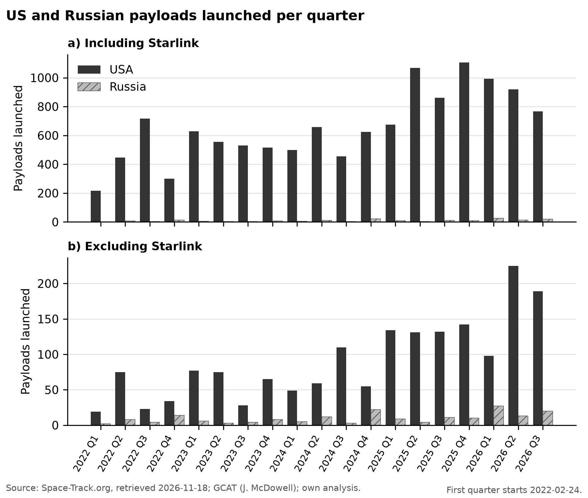
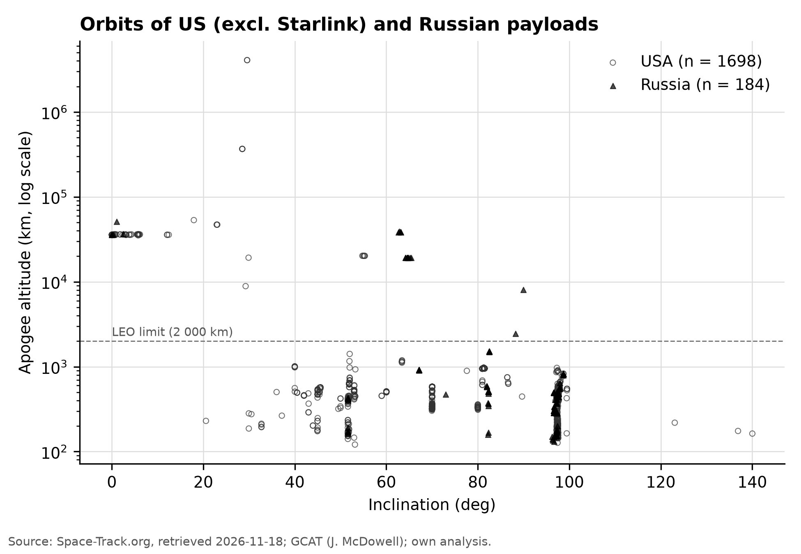

# US and Russian Satellite Launches 2022–2026 (RQ1, RQ2)

*Exported from the final team report (`OSINT_USA_Russia_Satellites_final.docx`): Sections 2.2, 3, 4.1, 4.2 and Appendix A. Data retrieved 18 November 2026.*

## 2.2 Scope and Definitions

The data analysis (RQ1–RQ2) covers all satellites owned by the USA and Russia that were launched between 24 February 2022 and 30 September 2026. Each satellite was assigned an orbit regime and an operator category (military, civil or commercial). The research part (RQ3–RQ4) looks at incidents from 2021 to 2026. The following subsections explain these choices.

### 2.2.1 Time Frame

The analysis starts on 24 February 2022, the beginning of the Russian full-scale invasion of Ukraine, when satellites became a visible part of the conflict (Bingen, 2025). It ends on 30 September 2026, the end of the last full quarter before the data were retrieved. RQ3–RQ4 start already in 2021 to include the Russian anti-satellite (ASAT) test of 15 November 2021. RQ3 covers attacks by or against US or Russian actors and also describes the close approach of Kosmos 2612 to ICEYE-X36 in October 2026 as the most recent case; attacks between other states, such as Iran’s jamming of Starlink (Ghosh, 2026) or North Korea’s GPS jamming (Secure World Foundation, 2026), are outside its scope. RQ4 counts incidents until 30 September 2026, the end of the study period.

### 2.2.2 US and Russian Satellites

A satellite counts as American or Russian by its owner country in the Space-Track satellite catalog (SATCAT): code US for the United States and CIS for Russia (Space-Track uses the code of the Commonwealth of Independent States for Russia and the former Soviet Union). The owner decides, not where or on which rocket the satellite was launched. Only satellites (payloads) are counted, not rocket stages or debris. Satellites launched in the period are counted even if they have since re-entered the atmosphere, because RQ1 asks how many were launched, not how many are still in orbit.

### 2.2.3 Orbit Regimes

Each satellite was assigned to an orbit regime by the rules in Table 2, applied from top to bottom to its current or last known orbit. Eccentricity (0 = circle) is calculated from the apogee and perigee as e = (ra − rp) / (ra + rp), where r is the altitude plus the Earth's radius (6,378 km). The LEO definition is the same as in ESA's Annual Space Environment Report; the rules for MEO, GEO and HEO are simplified (ESA Space Debris Office, 2025). H1 was also tested with the orbit classes of GCAT (Section 4.2).

| Regime | Rule | Typical use |
|---|---|---|
| LEO – low Earth orbit | Apogee below 2,000 km | Imaging and reconnaissance, Starlink, ISS |
| HEO – highly elliptical orbit | Strongly elongated orbit (eccentricity above 0.25) | Long coverage of northern latitudes (Russian Molniya and Tundra orbits) |
| GEO – geostationary orbit | One orbit per day (period 1,400–1,460 min), almost circular (eccentricity below 0.05); the satellite stays above one point on the equator | Communications, missile early warning |
| MEO – medium Earth orbit | All other orbits, typically around 20,000 km | Navigation (GPS, GLONASS) |
| Unknown | No published orbital data | Deep-space missions, some US military satellites |

**Table 2: Orbit regimes**

*Note.* Adapted from ESA Space Debris Office (2025, p. 14). LEO is defined as in the source; MEO, GEO and HEO are simplified.

### 2.2.4 Satellite Categories

Each satellite was assigned to one of five operator categories (Table 3).

| Category | Meaning | Examples |
|---|---|---|
| Military | Operated by armed forces or intelligence agencies, including dual-use systems run by the military | US NRO and DoD satellites (USA nnn), Space Development Agency, Russian COSMOS, GLONASS |
| Civil | Non-military government agencies, universities and amateur projects | NASA, Roscosmos (Soyuz, Progress), university CubeSats |
| Commercial | Private companies | Amazon Kuiper, Spire, AST SpaceMobile, Bureau 1440 (Rassvet) |
| Starlink | Commercial, but reported separately because it makes up 86 % of US satellites and would hide all other trends | SpaceX Starlink |
| Unknown | Could not be classified from open sources | Unidentified objects (OBJECT A, B, …) |

**Table 3: Satellite categories**

The classification rules are described in Section 3.3.

## 3 Methodology

## 3.1 Data Sources

The analysis combines two satellite catalogs (Table 4). Space-Track.org is the official catalog of the U.S. Space Force and gives the owner country, launch date and orbit of every tracked object (Space-Track.org, 2026). GCAT (General Catalog of Artificial Space Objects) (McDowell, 2026a) is an independent catalog maintained by astronomer Jonathan McDowell of the Harvard–Smithsonian Center for Astrophysics (McDowell, n.d.); unlike Space-Track, it records who operates each satellite and what it is used for, and it assigns each satellite its own orbit class. All tables and figures in Chapter 4 are based on these two sources and our own analysis.

| Source | What it provides | Used for |
|---|---|---|
| Space-Track.org (U.S. Space Force) | Official satellite catalog (SATCAT): owner country, launch date, orbital parameters. Retrieved 18 Nov 2026. Kosmos 1408 debris retrieved 4 Nov 2026. | RQ1, RQ2, RQ3 (debris) |
| GCAT – J. McDowell (planet4589.org) | Operator class, mission category and own orbit class of satellites; launch dates of ISS-deployed satellites. Version of 18 Nov 2026, retrieved 18 Nov 2026. | RQ1 classification, RQ2 verification |
| Counterspace reports (Secure World Foundation, CSIS), official statements, news | Documented incidents and reactions | RQ3, RQ4 |

**Table 4: Data sources**

## 3.2 Data Collection

Data were downloaded from the Space-Track.org API on 18 November 2026 (Space-Track.org, 2026) with three queries: US and Russian payloads launched in the study period, US and Russian payloads deployed from the ISS, and the debris of Kosmos 1408 (downloaded on 4 November 2026) (Table A1). Satellites released from the ISS are listed under the ISS launch of 1998, so their real launch dates were taken from GCAT; this added 26 satellites. After three non-satellite ISS objects were removed, the final dataset contains 12,718 satellites (12,533 US, 185 Russian). Details are given in Appendix A. Space-Track's terms of use do not allow redistribution of the data, so only aggregated results are published.

## 3.3 Classification of Satellites

Orbit regimes were assigned by the rules in Section 2.2.3. This section first gives an overview of how open sources classify satellites and then describes how each satellite got its operator category.

### 3.3.1 Classification Systems in Open Sources

No single official classification of satellites exists; open catalogs describe satellites along several dimensions. Each tracked object has a NORAD catalog number and a COSPAR international designator (e.g. 2022-150A = launch 150 of 2022, object A), which also identifies the launch. National designations often hide the purpose: the USA names most NRO and Department of Defense payloads USA nnn, and Russia names mainly military satellites COSMOS nnnn.

GCAT assigns each satellite an operator class (A academic, B business, C civil government, D defence, or combinations for dual use) and a mission category such as imaging, signals intelligence, communications or navigation (McDowell, 2026a). The UCS Satellite Database has similar fields, but its data end in May 2023 (Union of Concerned Scientists, 2023), so it was not used. The rules below map these dimensions to the five categories in Table 3.

### 3.3.2 Classification Rules

Each satellite went through the rules in Table 5 from top to bottom; the first rule that matches decides. Most satellites can be classified by their catalog name, the rest by their operator class in GCAT.

| Step | Rule | Category |
|---|---|---|
| 1 – catalog name | STARLINK | Starlink |
| 1 – catalog name | USA nnn (US government designation, mainly NRO and Department of Defense) | Military |
| 1 – catalog name | PRAETORIAN SDA (Space Development Agency) | Military |
| 1 – catalog name | COSMOS (designation of Russian military satellites) | Military |
| 1 – catalog name | RASSVET (Bureau 1440), GLOBALSTAR, SPACEMOBILE | Commercial |
| 1 – catalog name | SOYUZ, PROGRESS (ISS crew and cargo spacecraft) | Civil |
| 2 – GCAT operator class | D – defence (also mixed classes containing D) | Military |
| 2 – GCAT operator class | C – civil government; A – academic or amateur | Civil |
| 2 – GCAT operator class | B – business | Commercial |
| 3 | No rule matched | Unknown |

**Table 5: Classification rules (first match applies)**

*Note.* Name rules are based on McDowell (2026b) for USA designations, Zak (2026) for COSMOS, Space Development Agency (n.d.) for SDA and Krebs (2026) for RASSVET. GCAT operator classes are defined in the GCAT documentation (McDowell, 2026a).

GLONASS navigation satellites are also named COSMOS. They were identified by their GCAT mission category (6 satellites) and counted as military, because the system is operated by Roscosmos together with the Russian Ministry of Defence and serves both military and civilian users (eoPortal, 2026). A manual override list was prepared for disputed cases but has not been needed.

### 3.3.3 Cross-check with GCAT

The two sources agree well. Of 10,747 satellites classified by name that also appear in GCAT, 10,746 have the same category there. The only exception is COSMOS 2596, which GCAT lists as a civil technology demonstrator; it was kept as military. In total, 11,365 satellites were classified by name, 1,333 by GCAT and 6 as GLONASS.

### 3.3.4 Unclassified Satellites

14 satellites (0.1 %) remain unknown: 7 objects not yet identified in the catalog (named OBJECT A–E) and 7 objects missing from GCAT, mostly recent launches such as NASA's Nancy Grace Roman Space Telescope (NASA Science, 2023) or non-satellite payloads such as launch adapters and upper stages. GCAT currently covers launches until about mid-July 2026. Satellites launched later could only be classified by name, so their military mission type is not known (Table 7).

## 3.4 Use of AI

Claude Code (Anthropic; model Claude Opus 5.5) was used to write and debug the Python data pipeline, to explore the structure of the SATCAT and GCAT data and to draft parts of the methodology text. Decisions on the study period, classification rules and hypothesis test were made by the team. Outputs were verified by record counts and random samples printed after each step, by cross-checking the classification with GCAT, and by an independent code review in a separate AI session, which revealed the missing ISS-deployed satellites (Appendix A). The code is kept in a private GitHub repository (https://github.com/SirMar11/OSINT-satellite-tracking) because it also contains Space-Track data, which may not be redistributed; the lecturer can be given access on request, and the commit history shows how the code was developed.

For RQ3 and RQ4, Claude Code (Anthropic; model Claude Opus 5.5) was used to extract candidate incidents from the SWF and CSIS reports, search the web for official reactions, compile the incident file, write the script for Figure 3 and the orbit check, and draft Section 4.4, Appendix B and the additions to Section 4.3. The inclusion criteria were fixed before the search and approved by the team; each incident has at least two independent sources, all searches are logged in the repository, and figures taken from the reports were checked against the report text (Appendix C).

## 4.1 Launch Activity of the USA and Russia, 2022–2026 (RQ1)

### 4.1.1 Number of Launches and Payloads

#### Payloads per Quarter

Figure 1 shows how many satellites each country launched per quarter. Panel (a) includes Starlink; panel (b) leaves it out, so that the other US launches and the Russian launches are visible.

*Figure 1: Payloads launched per quarter*

The USA launched far more satellites than Russia in every quarter. Starlink makes up 86 % of all US payloads, but the gap remains large even without it: in 2025 the USA launched 539 non-Starlink payloads and Russia 34. Russian activity stayed roughly constant at about 17 launches and 20–60 payloads per year, while the number of US launches grew from 98 in 2023 to 174 in 2025. Russia is therefore not launching less than before; rather, the gap between the two countries is widening.

#### Totals by Category

Table 6 sums up the whole period by category. A launch is counted for a country if it carried at least one of its satellites.

| Category | USA | USA excl. Starlink | Russia |
|---|---|---|---|
| Orbital launches | 588 | 209 | 84 |
| Payloads total | 12,533 | 1,720 | 185 |
| Military | 514 | 514 | 71 |
| Civil | 99 | 99 | 63 |
| Commercial | 1,095 | 1,095 | 49 |
| Starlink | 10,813 | – | – |
| Unknown | 12 | 12 | 2 |

**Table 6: Launches and payloads by category**

Over the whole period, the USA launched 7 times more military satellites than Russia (514 vs. 71) and 22 times more commercial ones (1,095 vs. 49). The gap is smallest for civil satellites (99 vs. 63). A large part of the Russian civil count (25 of 63) consists of Soyuz and Progress spacecraft carrying crews and cargo to the ISS; the rest are mostly scientific, weather and university satellites.

The number of US military satellites grew every year, from 33 in 2022 to 162 in the first nine months of 2026. Most of the growth comes from large batches of satellites with USA nnn designations launched since 2024 and from Space Development Agency satellites launched since 2025, almost all of them in LEO. US commercial launches also rose sharply in 2025. Russian numbers are much smaller and less regular: military launches fell to 5 in 2024 and recovered to about 20 per year in 2025–2026, and all 32 Russian commercial satellites of 2026 belong to the new RASSVET broadband constellation. Note that 2022 and 2026 are not full years.

### 4.1.2 Military vs. Civil Classification

#### Military Satellites by Mission

Table 7 shows what the military satellites are used for, based on their GCAT mission category. Satellites launched after GCAT's coverage ends (about July 2026) are listed as “Not yet in GCAT”.

| Mission (GCAT category) | USA | Russia |
|---|---|---|
| Imaging / reconnaissance | 244 | 32 |
| Signals intelligence | 11 | 7 |
| Communications | 74 | 17 |
| Missile early warning | 23 | 1 |
| Navigation | 6 | 6 |
| Technology demonstration | 44 | 7 |
| Not yet in GCAT / other | 112 | 1 |
| Total | 514 | 71 |

**Table 7: Military payloads by mission**

Imaging and reconnaissance is the most common military mission for both countries: 244 of 514 US military satellites (47 %) and 32 of 71 Russian ones (45 %). In absolute numbers, the USA launched about 8 times more reconnaissance satellites than Russia. It also launched a much larger missile early-warning segment (23 vs. 1 satellite). For 112 US military satellites GCAT gives no mission in these categories: 110 are not yet in GCAT, mostly launched after July 2026, and 2 have other missions (science and meteorology), so the US numbers per mission are a lower bound.

## 4.2 Orbital Regimes (RQ2)

### 4.2.1 Orbit Regimes by Group

Table 8 compares the share of orbit regimes in five groups of satellites.

| Group | n | LEO | MEO | HEO | GEO | Unknown |
|---|---|---|---|---|---|---|
| USA | 12,533 | 99.2 % | 0.1 % | 0.1 % | 0.5 % | 0.2 % |
| USA excl. Starlink | 1,720 | 94.4 % | 0.4 % | 0.6 % | 3.3 % | 1.3 % |
| Russia | 185 | 88.1 % | 6.5 % | 2.7 % | 2.2 % | 0.5 % |
| US military | 514 | 90.5 % | 1.4 % | 0.0 % | 6.8 % | 1.4 % |
| Russian military | 71 | 80.3 % | 11.3 % | 5.6 % | 2.8 % | 0.0 % |

**Table 8: Orbit regimes by group (share of payloads)**

Table 8 confirms hypothesis H1: in every tested group, more than half of the satellites are in LEO, from 80.3 % for Russian military satellites to 94.4 % for US satellites excluding Starlink. Russia relies on other orbits more than the USA; most of its military satellites in MEO (11.3 %) are GLONASS navigation satellites. For US military satellites, GEO is the second most common regime (6.8 %). Figure A1 in Appendix A shows the orbits of individual satellites.

The growth of US military satellites in LEO matches the published plans of the Space Development Agency. Its Proliferated Warfighter Space Architecture is a constellation of data-transport and missile-tracking satellites in low Earth orbit; Tranche 1 alone will comprise 154 operational satellites (Space Development Agency, 2025).

### 4.2.2 Verification with a Second Source

To check that the result does not depend on one catalog or on our orbit rules, H1 was tested again with the orbit class assigned in GCAT (McDowell, 2026a), which is compiled independently of Space-Track and includes McDowell's own research. GCAT measures LEO by mean height and starts HEO at an eccentricity of 0.5, while our rules use the apogee and 0.25 (Section 2.2.3). Satellites without an orbit in GCAT were counted as unknown, which lowers the LEO share. Table 9 compares both sources.

| Group | n | LEO Space-Track | LEO GCAT | Orbit known in both | Regime differs | Not yet in GCAT |
|---|---|---|---|---|---|---|
| USA | 12,533 | 99.2 % | 94.5 % | 11,902 | 8 | 626 |
| USA excl. Starlink | 1,720 | 94.4 % | 87.3 % | 1,561 | 8 | 154 |
| Russia | 185 | 88.1 % | 79.5 % | 164 | 4 | 21 |
| US military | 514 | 90.5 % | 70.0 % | 397 | 2 | 113 |
| Russian military | 71 | 80.3 % | 80.3 % | 70 | 1 | 1 |

**Table 9: LEO share by source (Space-Track vs. GCAT)**

*Note.* Orbit known in both = satellites with a known regime in both catalogs; regime differs counts only these. Not yet in GCAT = satellites without a GCAT orbit class, mostly launched after about July 2026. The 113 US military satellites without a GCAT orbit are the 110 satellites missing from GCAT (Table 7) plus 3 (USA 582–584) that GCAT already lists with a mission but not yet with an orbit class.

H1 holds in both sources. The lowest LEO share is 80.3 % (Russian military satellites) by Space-Track and 70.0 % (US military satellites) by GCAT, both well above 50 %. Where both catalogs know the orbit, they agree almost completely: the regime differs for only 12 of 12,066 satellites (0.1 %), ten of them borderline cases between MEO, GEO and HEO. The GCAT shares are lower only because GCAT has no orbit yet for recent launches, mostly US military satellites launched after about July 2026 (113 of 514).

## Appendix A: Data Pipeline and Code

The complete code, the aggregated tables and figures and a short guide to running the analysis are kept in a private GitHub repository (https://github.com/SirMar11/OSINT-satellite-tracking); access for the lecturer is available on request. The analysis is written in Python 3.13 and uses the libraries pandas, requests, matplotlib and python-dotenv. It consists of five scripts that are run in this order:

- 01_download.py – downloads data from the Space-Track API: US and Russian payloads launched between 24 February 2022 and 30 September 2026, and US and Russian payloads deployed from the ISS. Each file is saved with the download date in its name. Login details are stored in a local .env file, not in the repository.

- 02_classify.py – adds the ISS-deployed satellites with launch dates from GCAT and assigns each satellite its launch, operator category (name rules, GCAT operator class, manual overrides) and orbit regime (from Space-Track, and from GCAT for verification). Record counts and random samples are printed after each step for checking.

- 03_charts.py – creates the tables and figures for Sections 4.1 and 4.2 and evaluates hypothesis H1 in both sources.

- 04_debris.py – downloads the catalogued debris of Kosmos 1408 and counts the pieces still in orbit at the end of each month (Section 4.3.1).

- 05_incidents.py – creates the incident timeline (Figure 3) and Table 11 from the project’s incident file and checks the orbital planes of co-orbital incidents with Space-Track element history (Section 4.4).

The raw and processed data are kept in the team’s private repository so that all members work with the same files; because the Space-Track terms of use do not allow their redistribution, the repository must stay private and only aggregated results are published. Anyone with a free Space-Track account can download the data again with the scripts. The GCAT catalogs are downloaded manually as described in the README file.

## Space-Track Queries

Table A1 lists the three queries used to download the data (Section 3.2).

| Query | Filter (class satcat) | Records | Used for |
|---|---|---|---|
| 1 – Main dataset | OBJECT_TYPE = PAYLOAD; COUNTRY = US, CIS; LAUNCH 2022-02-24 to 2026-09-30 | 12,692 (12,512 US, 180 RU) | RQ1, RQ2 |
| 2 – ISS-deployed satellites | OBJECT_TYPE = PAYLOAD; COUNTRY = US, CIS; INTLDES 1998-067* | 240 (all years) | RQ1, RQ2 |
| 3 – Kosmos 1408 debris | INTLDES 1982-092* | 1,808 | RQ3 |

**Table A1: Space-Track queries**

*Note.* The 1,808 records of query 3 are the satellite Kosmos 1408, its rocket stage and 1,806 debris pieces.

## Satellites Deployed from the ISS

Small satellites (CubeSats) are often carried to the ISS as cargo and released into orbit weeks or months later. Space-Track lists them under the ISS designator and the ISS launch date (20 November 1998), so the date filter of the main query misses them completely. We therefore downloaded them separately (query 2) and took the real launch date and designator of their cargo flight from GCAT. This added 26 satellites launched in the study period (21 US, 5 Russian), mostly university CubeSats.

## Excluded Objects and Final Dataset

Rocket bodies and debris were excluded by the queries, which return payloads only. Three ISS objects that GCAT does not list as satellites (items released during spacewalks) were dropped. Satellites without published orbital data (23, mostly deep-space missions and 7 US military satellites) were kept with the orbit regime “unknown”. The final dataset contains 12,718 satellites (12,533 US, 185 Russian) with no duplicates.

## Inclination and Altitude

Figure A1 places every US (without Starlink) and Russian satellite by its inclination and highest altitude, which shows the typical orbit families of both countries.

*Figure A1: Inclination vs. apogee altitude*

The scatter plot shows what Table 8 already suggested: a larger share of Russian satellites is above LEO (11 % vs. 4 % of US satellites excluding Starlink). Russian satellites form two distinct groups at an inclination of about 63–65°: GLONASS navigation satellites at about 19,000 km, and satellites on highly elliptical orbits reaching about 40,000 km, which give long coverage of northern latitudes. US satellites above LEO are mostly in GEO, near 0° inclination.

The US points far above the rest are not Earth-orbiting satellites but lunar and planetary missions that are catalogued on their transfer orbits: three payloads from the IM-2 rideshare launch in February 2025 (e.g. NASA's Lunar Trailblazer, apogee about 367,500 km) and NASA's two ESCAPADE Mars probes (Rocket Lab, n.d.) launched in November 2025 (about 4.1 million km). Because of these transfer orbits, they are classified as HEO; together with the Artemis II Orion capsule, they account for 6 of the 11 US payloads in this regime.

## References

- Bingen, K. A. (2025). Extending the Battlespace to Space. https://www.csis.org/analysis/chapter-8-extending-battlespace-space
- eoPortal. (2026, September 24). GLONASS. https://www.eoportal.org/satellite-missions/glonass
- ESA Space Debris Office. (2025). ESA’s annual space environment report (Issue 9.1 GEN-DB-LOG-00288-OPS-SD). European Space Agency. https://www.sdo.esoc.esa.int/publications/Space_Environment_Report_I9R1_20251021.pdf
- Ghosh, I. (2026, January 13). Iran crippled Starlink and why the rest of the world should worry. Rest of World. https://restofworld.org/2026/iran-starlink-internet-shutdown/
- Krebs, G. D. (2026, March 23). Rassvet-1 1, 2, 3. Gunter’s Space Page. https://space.skyrocket.de/doc_sdat/rassvet-1.htm
- McDowell, J. C. (2026a). General catalog of artificial space objects (GCAT) (Version 1.8.8) [Data set]. https://planet4589.org/space/gcat/
- McDowell, J. C. (2026b). Space activities in 2025 [Rev 1.4]. https://www.planet4589.org/space/papers/space25.pdf
- McDowell, J. C. (n.d.). Jonathan McDowell. Planet4589. Retrieved November 5, 2026, from https://planet4589.org/jcm/index.html
- NASA Science. (2023, June 15). Nancy Grace Roman Space Telescope. https://science.nasa.gov/mission/roman-space-telescope/
- Rocket Lab. (n.d.). Escapade. Rocket Lab. Retrieved November 5, 2026, from https://rocketlabcorp.com/missions/escapade/
- Secure World Foundation. (2026). Global counterspace capabilities: An open source assessment (V. Samson & K. Brett, Eds.). https://www.swfound.org/counterspace/
- Space Development Agency. (2025, September 11). Space Development Agency completes successful launch of First Tranche 1 satellite. United States Space Force. https://www.spaceforce.mil/News/Article-Display/Article/4300726/space-development-agency-completes-successful-launch-of-first-tranche-1-satelli/
- Space Development Agency. (n.d.). About us. Retrieved November 4, 2026, from https://www.sda.mil/home/about-us/
- Space-Track.org. (2026). Satellite catalog (SATCAT) [Data set]. https://www.space-track.org/#catalog
- Union of Concerned Scientists. (2023). UCS Satellite Database [Data set]. https://www.ucs.org/resources/satellite-database
- Zak, A. (2026, April 22). Russia’s military spacecraft. RussianSpaceWeb. https://www.russianspaceweb.com/spacecraft_military.html
