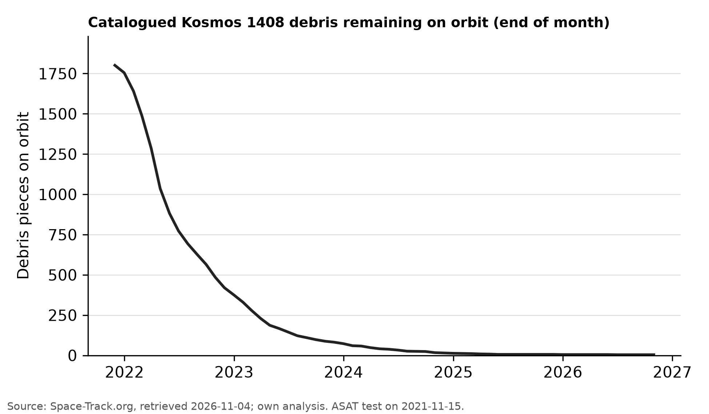
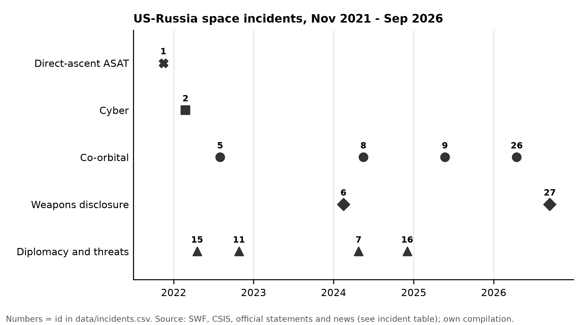

# Attacks and Incidents in Space, USA vs Russia 2021–2026 (RQ3, RQ4)

*Exported from the final team report (`OSINT_USA_Russia_Satellites_final.docx`): Sections 4.3, 4.4 and Appendix B. Research completed 23 November 2026.*

## 4.3 Documented Attacks and Counterspace Activities (RQ3)

For this question, an attack is any deliberate action intended to destroy, damage, disable or interfere with a satellite, its signals, or its ground and user equipment. Incidents were sorted into the five categories used by the Secure World Foundation (SWF): co-orbital, direct-ascent, electronic warfare, directed energy and cyber (Samson & Brett, 2026). Each incident was also given an evidence level: *confirmed* (admitted by the actor, or formally attributed by several governments with supporting technical data), *attributed* (named by a government without public technical evidence) or *claimed or suspected* (reported only by the victim, the media or a hacker group). Only attacks by or against US or Russian actors are included (Section 2.2.1).

Table 10 lists the incidents found. The only destructive event in the period was the Russian test against its own satellite in November 2021; no satellite of another country was destroyed or physically damaged in the open record. All hostile actions against other countries’ space systems were non-destructive: jamming, cyberattacks and close approaches. This matches the SWF finding that only non-destructive counterspace capabilities are being used in active conflicts (Samson & Brett, 2026). We found no publicly documented directed-energy (laser) attack in the period.

| Date | Incident | Category | Actor; evidence | Main consequences |
|---|---|---|---|---|
| 15 Nov 2021 | Ground-launched missile destroys the inactive Russian satellite Kosmos 1408 | Direct-ascent (kinetic) | Russia; confirmed (Russian MoD, US government) | 1,806 catalogued debris pieces; ISS crew shelters; US test moratorium; UNGA resolution 77/41 |
| 24 Feb 2022 | AcidRain wiper malware disables modems of the Viasat KA-SAT network | Cyber | Russia; confirmed (EU, UK and US attribution, May 2022) | Outages in Ukraine and Europe; 5,800 German wind turbines lose remote access; almost 30,000 routers replaced |
| 2022–2026 | Jamming and spoofing of GPS signals in Ukraine and, since late 2023, over the Baltic | Electronic warfare | Russia; attributed (European governments; ICAO, October 2025) | Less accurate US-supplied weapons (JDAM, HIMARS); thousands of aviation interference cases per month; flight suspensions |
| 2022–2026 | Jamming of Starlink terminals used by Ukrainian forces (e.g. Volna Kupol Garant) | Electronic warfare | Russia; claimed (Ukrainian officials) | Local, temporary outages; in 2022 countered quickly by SpaceX software updates |
| Aug 2022 – May 2025 | Kosmos 2558, 2576 and 2588 placed in the orbital planes of US reconnaissance satellites | Co-orbital | Russia; attributed (US Space Command) | No damage; US calls the satellites counterspace weapons |
| Jun 2023 | Cyberattack on Dozor-Teleport, a Russian satellite internet provider serving the FSB and the military | Cyber | Hackers claiming Wagner affiliation; claimed | Ground infrastructure and user terminals damaged; service offline |
| 2024 | Jamming and hijacking of European and Ukrainian TV broadcasting satellites | Electronic warfare | Russia; attributed (Swedish and French authorities via the ITU) | Interrupted programmes; Russian war footage shown on Ukrainian TV; ITU: “extremely worrisome and unacceptable” |
| 2025 | Jamming of UK satellites and of the German military; Luch/Olymp satellites track Intelsat satellites in GEO | Electronic warfare, co-orbital | Russia; attributed (UK and German defence officials) | No lasting damage; Germany plans €35 bn for space programmes |
| 16–18 Oct 2026 | Kosmos 2612 approaches the US-registered commercial radar satellite ICEYE-X36 | Co-orbital | Russia; attributed (US at the UN; COMSPOC and LeoLabs data) | No damage reported; debate on protecting commercial satellites |

**Table 10: Documented attacks and counterspace activities, 2021–2026**

*Note.* Own compilation based on the sources cited in Sections 4.3.1–4.3.3. Evidence levels as defined above.

### 4.3.1 Kinetic Attacks (Direct-Ascent ASAT)

On 15 November 2021 Russia destroyed its own inactive satellite Kosmos 1408, in orbit since 1982, with a ground-launched missile. The US government reported that the test had produced more than 1,500 pieces of trackable debris and would likely produce hundreds of thousands of smaller fragments (Office of Space Commerce, 2021). The Russian Ministry of Defence confirmed the test a day later, but said that the remaining debris posed no threat to space activities (TASS, 2021). The seven crew members of the International Space Station (ISS), including two Russian cosmonauts, had to take shelter several times as the station’s orbit crossed the debris (Bugos, 2021).

#### Debris from the Kosmos 1408 Test

Figure 2 shows how many catalogued debris pieces of the Russian satellite Kosmos 1408, destroyed in the anti-satellite test of 15 November 2021, remained in orbit at the end of each month (own analysis of Space-Track data; debris pieces share the satellite’s designator 1982-092).

*Figure 2: Kosmos 1408 debris remaining in orbit*

The test created 1,806 catalogued debris pieces, more than reported shortly after the test (Office of Space Commerce, 2021), because further pieces were catalogued later. About half re-entered the atmosphere within six months (882 pieces remained at the end of May 2022), fewer than 20 remained after almost three years (17 in October 2024), and four were still in orbit at the end of October 2026. Because the debris was released in low Earth orbit, where most US and Russian satellites operate (Section 4.2), a single test endangered other spacecraft for several years.

Politically, the test led to a new norm: on 18 April 2022 the United States committed not to conduct destructive direct-ascent ASAT tests, and on 7 December 2022 the UN General Assembly called on all states to do the same in resolution 77/41, adopted by 155 votes to 9, with Russia and China against (Smith, 2022; United Nations General Assembly, 2022).

### 4.3.2 Co-orbital Activities and Proximity Operations

Russia has repeatedly placed satellites of its Nivelir inspection programme in the same orbital plane as US reconnaissance satellites. Kosmos 2558 (launched 1 August 2022) shared the plane of USA 326, and Kosmos 2576 (launched 16 May 2024) the plane of USA 314 (Hendrickx, 2025). After the second launch, US Space Command assessed that Kosmos 2576 was likely a counterspace weapon capable of attacking other satellites in low Earth orbit (Al Jazeera, 2024). Kosmos 2588, launched on 23 May 2025 into the plane of USA 338, passes within about 94 km of its target roughly every four days, according to Slingshot Aerospace (Hitchens, 2025). In 2026 the commander of US Space Command said it was evident that Russia was deploying a space weapon with Kosmos 2558 (Swope & Li, 2026).

This case also shows the value of OSINT: the orbits of US reconnaissance satellites are not published in Space-Track, and the orbit of Kosmos 2588 matching USA 338 was first noticed by observers outside government, not announced by the US (Hitchens, 2025).

The closest documented approach to a Western satellite took place in October 2026. In April 2026 Russia launched six satellites, Kosmos 2609 to 2614, and by May five of them were in or near the orbital plane of an ICEYE satellite (Swope & Li, 2026). The target, ICEYE-X36, is a US-registered radar satellite operated by ICEYE US, whose company supplies radar imagery to Ukraine. It counts as a US target because it is registered in the USA and the US Space Force reacted officially; our own data show Kosmos 2612 in practically the same orbital plane as ICEYE-X36 from 18 April 2026 (Section 4.4). Between 16 and 18 October 2026 Kosmos 2612 spent about 24 hours within 2 km of ICEYE-X36; tracking companies estimated the closest pass at 60–500 m. On 21 October the United States told a UN committee that the manoeuvres appeared “consistent with an on-orbit weapons operation”, which Russia called unfounded. No damage has been reported (Gramegna, 2026).

Similar behaviour is documented in geostationary orbit. In September 2025 the German defence minister Boris Pistorius said that two Russian Luch/Olymp reconnaissance satellites were tracking two Intelsat satellites used, among others, by the German armed forces, and that the German military had already been targeted by jamming attacks (Associated Press, 2025).

### 4.3.3 Electronic and Cyber Attacks

The best-documented attack of the period targeted the user segment rather than a satellite. On 24 February 2022, the day of the Russian invasion of Ukraine, the AcidRain wiper malware disabled modems of the Viasat KA-SAT network. Thousands of customers in Ukraine and tens of thousands elsewhere in Europe lost internet access, remote access to about 5,800 wind turbines in Germany was lost, and Viasat shipped almost 30,000 replacement routers. On 10 May 2022 the EU, the United Kingdom and the United States formally blamed Russia (Page, 2022). The primary target is believed to have been the Ukrainian military, but the effects spread to civilian users in several EU countries.

The most widespread interference targets GPS, a US government system used worldwide. Russian jamming and spoofing of GPS in Ukraine reduced the accuracy of US-supplied weapons: the hit rate of JDAM guidance kits stayed at about 60 % for most of 2023, and GMLRS rockets fired by HIMARS launchers at times missed their targets by 50 feet. Since late 2023 the interference has also disrupted civil aviation and shipping over the Baltic; Poland alone reported 2,732 aviation interference cases in January 2025. In June 2025 seventeen EU ministers called for a common response, and in October 2025 the ICAO Assembly found the interference to be an infringement of the Chicago Convention (Secure World Foundation, 2026).

Russia has also tried to jam the Starlink terminals used by Ukrainian forces. According to the Ukrainian government adviser Serhii Beskrestnov, the first successful Russian jamming of Starlink was recorded on the Kharkiv front in 2023, and the Volna Kupol Garant system is now used against it (Shevko, 2026). These reports come from one side of the war and are difficult to verify independently. The effect appears local and temporary: in 2022 SpaceX countered the jamming quickly with a software update, which a US Defense Department official called “eyewatering” (Insinna, 2022).

Military satellites of other Western countries are targeted as well: in October 2025 the head of UK Space Command said that Russia tries to jam British satellites weekly (Agence France-Presse, 2025).

Commercial broadcasting satellites were jammed too. In 2024 several European countries complained that their TV satellites were being targeted, in some cases to show images of the war in Ukraine; in July 2024 the ITU Radio Regulations Board said that the interference with Swedish and French satellites seemed to originate from earth stations near Moscow, Kaliningrad and Pavlovka and called it “extremely worrisome and unacceptable” (Secure World Foundation, 2026). Russian space systems were attacked as well: in June 2023 hackers claiming affiliation with the Wagner group attacked Dozor-Teleport, a satellite internet provider serving the FSB and the Russian military, damaged its ground infrastructure and user terminals and took the service offline (Secure World Foundation, 2026; Swope et al., 2024).

### 4.3.4 Consequences

The consequences fall into three groups. Physical consequences were limited to the Kosmos 1408 test, whose debris mostly decayed within three years, although four pieces were still in orbit in October 2026 (Figure 2). Electronic and cyber attacks were temporary and reversible, but reached civilian users: the Viasat case shows that the weakest point of a satellite system is often the user terminal, not the satellite. The largest consequences were political: a new norm against destructive ASAT tests, the formal attribution of the Viasat attack to Russia, ICAO and ITU protests against Russian jamming and growing military investment in space; Germany, for example, announced €35 billion for its space programmes over five years (Associated Press, 2025). The political reactions are analysed in Section 4.4.

## 4.4 Space Incidents Increasing US–Russia Tension, 2021–2026 (RQ4)

### 4.4.1 Selection of Incidents

An event was counted as an incident that increased US–Russia tension only if it met two conditions: (1) one country did something that affected, threatened or targeted a space system of the other, or changed the rules between the two in space (for example a veto, a test moratorium or a weapons disclosure); and (2) the other country’s government reacted officially – with a statement, a formal attribution, a diplomatic step or a UN vote. Media reports or intelligence leaks without official confirmation were not enough. The second condition makes the increase in tension checkable: an event counts only if the other side officially took notice of it.

The initiator of an incident is the country whose step triggered the other side’s official reaction. In the UN cases this is the side whose proposal or veto was reacted to: the US test moratorium and the US–Japan–Argentina resolution count as US steps because Russia opposed them, while Russia’s veto of the US–Japan draft counts as a Russian step because the White House reacted to the veto (incidents 15, 16 and 7). The moratorium and the resolution are norm-building rather than hostile steps; they are included because they changed the rules between the two countries and drew official Russian opposition.

Candidates were collected from the SWF report (Secure World Foundation, 2026), which covers events up to February 2026, and from the CSIS Space Threat Assessments 2022–2025 (Harrison et al., 2022; Bingen et al., 2023; Swope et al., 2024, 2025). Twenty targeted web searches then looked for official reactions to each candidate and for events between March and September 2026. Each incident was assigned one type – direct-ascent, co-orbital, electronic warfare or cyber (the SWF categories used in Section 4.3), weapons disclosure, or diplomacy and threats – and needed at least two independent sources and a reliability rating by the NATO Admiralty Code. All candidates, decisions and searches are recorded in the project repository. Of 28 candidates, 12 met both conditions (Appendix B). The full SWF report cited here (Secure World Foundation, 2026) is a different document from the shorter SWF summary cited in Section 4.3 (Samson & Brett, 2026).

### 4.4.2 Incidents and Their Timeline

Figure 3 shows the twelve incidents on a timeline, and Table 11 sums them up by type and year. Appendix B lists each incident with its official reaction and sources (Table B1), together with the candidates that did not qualify (Table B2).

*Figure 3: Timeline of US–Russia space incidents, November 2021 – September 2026*

*Note.* Numbers are the incident IDs in Table B1 (Appendix B). Weapons disclosures are dated by the disclosure. Own compilation.

| Type | 2021 | 2022 | 2023 | 2024 | 2025 | 2026 | Total |
|---|---|---|---|---|---|---|---|
| Direct-ascent ASAT | 1 | 0 | 0 | 0 | 0 | 0 | 1 |
| Cyber | 0 | 1 | 0 | 0 | 0 | 0 | 1 |
| Electronic warfare | 0 | 0 | 0 | 0 | 0 | 0 | 0 |
| Co-orbital | 0 | 1 | 0 | 1 | 1 | 1 | 4 |
| Weapons disclosure | 0 | 0 | 0 | 1 | 0 | 1 | 2 |
| Diplomacy and threats | 0 | 2 | 0 | 2 | 0 | 0 | 4 |
| Total | 1 | 4 | 0 | 4 | 1 | 2 | 12 |

**Table 11: US–Russia space incidents by type and year**

*Note.* 2021 from November; 2026 until 30 September.

Russia initiated nine of the twelve incidents; without the two norm-building steps, nine of the remaining ten. This share is partly a result of the method: the sources and searches were in English, so official Russian reactions to US steps were harder to find than US reactions to Russian ones (Section 5.3). The three US-led steps – the moratorium on destructive ASAT tests, the UN General Assembly resolution against nuclear weapons in orbit and the acknowledgement of US space weapons – were each opposed by Russia, by a vote against (United Nations General Assembly, 2022; United Nations General Assembly, 2024) or by an official statement (Reuters, 2026).

The most common types were co-orbital approaches and diplomacy and threats (4 each). All four co-orbital incidents – Kosmos 2558, 2576 and 2588 near the reconnaissance satellites USA 326, USA 314 and USA 338, and Kosmos 2609–2614 near ICEYE-X36 – targeted imaging satellites in LEO (Section 4.3.2). These targets match the results of RQ1 and RQ2: imaging and reconnaissance is the most common US military mission (Table 7), and 90.5 % of US military satellites are in LEO (Table 8).

The tension escalated in three phases. In 2021–2022 it came from direct actions: the destructive ASAT test, the Viasat cyberattack and Russian warnings that Western commercial satellites could become “a legitimate target for retaliation”, to which the White House replied that the USA would hold Russia accountable for any attack (The Moscow Times, 2022; Agence France-Presse, 2022). In 2024–2025 the dispute moved to intelligence and diplomacy: the USA disclosed a Russian nuclear ASAT programme (PBS NewsHour, 2024), Russia vetoed a UN Security Council resolution against weapons of mass destruction in orbit (SpacePolicyOnline, 2024b), and new Kosmos satellites appeared in the orbits of US reconnaissance satellites. In 2026 the commanders of US Strategic Command and US Space Command warned the Senate about Russian counterspace weapons (U.S. Department of Defense, 2026), and the US Air Force acknowledged space control weapons of its own (Liang, 2026).

The most frequent hostile activity is not visible as tension. Russian jamming of Starlink and GPS affected US systems for years (Section 4.3.3), yet the US government made no official protest; a State Department official even described satellite jamming as normal in wartime (Breaking Defense, 2022). Under our criteria, this jamming is an attack (RQ3) but not an incident (RQ4).

### 4.4.3 Verification with Own Orbital Data

For the four co-orbital incidents, the history of orbital elements of both satellites was downloaded from Space-Track for 90 days after each event, and the angle between their orbital planes was computed; a median angle below 1° counts as co-planar (Table 12). Co-planarity shows that two satellites share an orbital plane, not how close they come: their distance also depends on their altitudes and positions along the orbit.

| ID | Russian satellite | US satellite | Result |
|---|---|---|---|
| 26 | Kosmos 2612 | ICEYE-X36 | Confirmed: median plane angle 0.13° (254 pairs, minimum 0.02°), 18 Apr – 14 Jul 2026 |
| 5 | Kosmos 2558 | USA 326 | Cannot be checked: no published orbital elements for the US satellite |
| 8 | Kosmos 2576 | USA 314 | Cannot be checked: no published orbital elements for the US satellite |
| 9 | Kosmos 2588 | USA 338 | Cannot be checked: no published orbital elements for the US satellite |

**Table 12: Orbital-plane check of co-orbital incidents**

*Note.* Own analysis of Space-Track GP history; element sets of the two satellites paired within one day.

Our data confirm that Kosmos 2612 flew in practically the same orbital plane as ICEYE-X36 from April to July 2026. The three NRO satellites cannot be checked: Space-Track publishes orbital elements for the Russian satellites but none for USA 326, USA 314 and USA 338. The US government thus hides the orbits of exactly the satellites that Russia shadows, and the co-orbital claims for these incidents rest on official US statements and on independent trackers (Hitchens, 2025).

## Appendix B: Incident Log

Table B1 lists the twelve incidents of Section 4.4 in chronological order with their official reactions and sources; the ID is the incident’s record in the project’s incident file and is also used in Figure 3. Table B2 lists the candidates that did not meet the criteria. All incidents are supported by at least two independent sources and is rated by the NATO Admiralty Code (in brackets in the Sources column): A1 = UN records or official documents confirmed by both sides; B1 = official statement or attribution confirmed by independent sources or our own data; B2 = official statement of one side supported by independent reporting or tracking; B3 = intelligence-based claim of one side that the other side denies.

| ID | Date | Event | Type | Official reaction | Sources |
|---|---|---|---|---|---|
| 1 | 15 Nov 2021 | Russian DA-ASAT test destroys Kosmos 1408; ISS crew shelters | Direct-ascent ASAT | US government condemns the test (State Department, US Space Command) | Office of Space Commerce (2021); Bugos (2021) [A1] |
| 2 | 24 Feb 2022 | Cyberattack on the Viasat KA-SAT network | Cyber | USA, UK and EU attribute the attack to Russia (May 2022) | Page (2022); CyberPeace Institute (2022) [B1] |
| 15 | 18 Apr 2022 | USA commits not to conduct destructive DA-ASAT tests | Diplomacy and threats | Russia votes against UNGA resolution 77/41 (Dec 2022) | The White House (2022); United Nations General Assembly (2022) [A1] |
| 5 | 1 Aug 2022 | Kosmos 2558 launched into the orbital plane of USA 326 | Co-orbital | US Space Command: “dangerous and irresponsible behavior” | Space.com (2022); Hendrickx (2025) [B2] |
| 11 | 26 Oct 2022 | Russian diplomat at the UN: Western commercial satellites may be “a legitimate target for retaliation” | Diplomacy and threats | White House: the USA will “hold Russia accountable” for any attack | The Moscow Times (2022); Agence France-Presse (2022) [B1] |
| 6 | 15 Feb 2024 | US discloses a Russian nuclear ASAT programme linked to Kosmos 2553 | Weapons disclosure | White House confirms a “troubling” capability; Russia denies it | PBS NewsHour (2024); SpacePolicyOnline (2024a); U.S. Department of Defense (2026) [B3] |
| 7 | 24 Apr 2024 | Russia vetoes the US–Japan UN Security Council resolution on weapons of mass destruction in orbit | Diplomacy and threats | White House criticises the veto | SpacePolicyOnline (2024b); Axios (2024); United Nations Security Council (2024) [A1] |
| 8 | 16 May 2024 | Kosmos 2576 launched into the orbit of USA 314 | Co-orbital | US at the UN: “likely a counterspace weapon”; Russia: “fake news” | Al Jazeera (2024); The Moscow Times (2024); Secure World Foundation (2026) [B2] |
| 16 | 2 Dec 2024 | UN General Assembly adopts a US–Japan–Argentina resolution against nuclear weapons in orbit | Diplomacy and threats | Russia votes against after its amendments are rejected | United Nations General Assembly (2024); Arms Control Association (2024) [A1] |
| 9 | 23 May 2025 | Kosmos 2588 placed in an orbit near USA 338 | Co-orbital | US Space Command confirms the orbit near a US government satellite | Hitchens (2025); Swope & Li (2026) [B2] |
| 26 | Apr–May 2026 | Six Kosmos satellites (2609–2614) launched in April 2026; by May five are in or near the orbital plane of ICEYE-X36 | Co-orbital | US Space Force statement on Russian satellites near a “Western commercial radar satellite used by Ukraine” (May–July 2026; sources differ on the date) | Swope & Li (2026); Wolf (2026); Eckel (2026) [B1] |
| 27 | 14 Sep 2026 | US Air Force acknowledges US space control weapons in orbit | Weapons disclosure | Russian Deputy Foreign Minister Ryabkov: Moscow was not notified; calls for a binding treaty | Liang (2026); Reuters (2026) [B2] |

**Table B1: US–Russia space incidents, November 2021 – September 2026**

*Note.* ID = record in the project’s incident file (data/incidents.csv), also used in Figure 3. Sources as cited in the reference list.

| Candidate | Reason for exclusion |
|---|---|
| Russian jamming of Starlink in Ukraine (2022–2026) | Attack under RQ3, but no official US protest |
| Russian jamming and spoofing of GPS (2022–2026) | Attack under RQ3; reactions by European governments and ICAO, not by the USA |
| Jamming of European TV broadcasting satellites (2024) | Attack under RQ3; no US target |
| Cyberattack on Dozor-Teleport (Jun 2023) | Attack under RQ3; no US actor |
| Russian threat against Starlink at the UN working group on space threats (Sep 2022) | No US reaction to this statement found |
| Repeated Russian threat against “quasi-civilian” satellites (Oct 2023) | Could not be confirmed as a separate statement |
| Russian Foreign Ministry: private systems serving the US military are “legitimate targets” (Mar 2024) | No US reaction found |
| Roscosmos head: cyberattacks on Russian satellites are a cause for war (Mar 2022) | US officials declined to respond |
| Roscosmos head: Russia will “respond” to weapons in space (Nov 2024) | No US reaction found |
| Reported CIA interception of Russian satellite traffic from Ukraine (Feb 2024) | No Russian reaction to the satellite claim |
| US Meadowlands satellite jammers fielded (Apr 2025) | No Russian reaction found |
| Luch/Olymp satellites near Intelsat satellites in GEO (2021–2025) | No US reaction (Germany protested) |
| Russia announces its exit from the ISS (Jul 2022) | Step in cooperation, not a threat; no formal NASA reaction |
| Killnet DDoS attack on Starlink (Nov 2022) | Non-state actor, no attribution to Russia |
| “Zone effect” weapon against Starlink reported (Dec 2025) | Intelligence report without official confirmation |
| Ukrainian drone strikes on Russian space surveillance radars (2024–2025) | No US actor; not a space system |
| Close approach of Kosmos 2612 to ICEYE-X36 (16–18 Oct 2026) | After the study period (30 Sep 2026); described in Section 4.3.2 |

**Table B2: Candidates that did not qualify for RQ4**

## References

- Agence France-Presse. (2022, October 27). US to "hold Russia accountable" if satellites attacked: White House. Prothom Alo. https://en.prothomalo.com/international/2itsp0ymnt
- Agence France-Presse. (2025, October 3). Russia regularly targeting UK satellites: Space command boss. SpaceWar. https://www.spacewar.com/reports/Russia_regularly_targeting_UK_satellites_space_command_boss_999.html
- Al Jazeera. (2024, May 22). Russia launches “space weapon” in path of US satellite: Pentagon. Al Jazeera. https://www.aljazeera.com/news/2024/5/22/russia-launches-space-weapon-in-path-of-us-satellite-pentagon
- Arms Control Association. (2024, December). UN reaffirms Outer Space Treaty. Arms Control Today. https://www.armscontrol.org/act/2024-12/news/un-reaffirms-outer-space-treaty
- Associated Press. (2025, September 25). Russia is tracking two satellites used by Germany’s military, defense minister says. PBS NewsHour. https://www.pbs.org/newshour/world/russia-is-tracking-two-satellites-used-by-germanys-military-defense-minister-says
- Axios. (2024, April 24). Russia vetoes UN resolution denouncing use of nuclear weapons in space. https://www.axios.com/2024/04/24/russia-nuclear-weapons-space-un-resolution
- Bingen, K. A. (2025). Extending the Battlespace to Space. https://www.csis.org/analysis/chapter-8-extending-battlespace-space
- Bingen, K. A., Johnson, K., Young, M., & Raymond, J. (2023). Space threat assessment 2023. Center for Strategic and International Studies. http://aerospace.csis.org/wp-content/uploads/2023/04/230414_Bingen_SpaceThreatAssessment_2023_UPDATED-min.pdf
- Breaking Defense. (2022, March). Satellite jamming normal by militaries during conflict, not peacetime: State Dept official. https://breakingdefense.com/2022/03/satellite-jamming-normal-by-militaries-during-conflict-not-peacetime-state-dept-official/
- Bugos, S. (2021, December). Russian ASAT test creates massive debris. Arms Control Today. https://www.armscontrol.org/act/2021-12/news/russian-asat-test-creates-massive-debris
- CyberPeace Institute. (2022, June). Viasat. Cyber Attacks in Times of Conflict Platform. https://cyberconflicts.protect.ngo/law-and-policy/cases/viasat
- Eckel, M. (2026, October 19). Star Wars: A Russian military satellite gets very, very close to one used by Ukraine. Radio Free Europe/Radio Liberty. https://www.rferl.org/a/russia-space-satellite-ukraine-finland/33879458.html
- Gramegna, A. (2026, November 19). Russian military satellite’s approach to American spacecraft looked like a weapons operation, US says. Military.Com. https://www.military.com/us-says-russian-military-satellites-approach-to-an-american-spacecraft-looked-like-a-weapons-operation-us
- Harrison, T., Johnson, K., Young, M., Wood, N., & Goessler, A. (2022). Space threat assessment 2022. Center for Strategic and International Studies. http://aerospace.csis.org/wp-content/uploads/2022/05/Harrison_SpaceThreatAssessment2022_WEB_v3-compressed.pdf
- Hendrickx, B. (2025, April 28). Project Nivelir: Russia’s inspection satellites (part 1). The Space Review. https://thespacereview.com/article/4979/1
- Hitchens, T. (2025, May 30). Russia’s new Cosmos satellite orbiting near US sat, piques ASAT fears. Breaking Defense. https://breakingdefense.com/2025/05/russias-new-cosmos-satellite-orbiting-near-us-sat-piques-asat-fears/
- Insinna, V. (2022, April 20). SpaceX beating Russian jamming attack was “eyewatering”: DoD official. Breaking Defense. https://breakingdefense.com/2022/04/spacex-beating-russian-jamming-attack-was-eyewatering-dod-official/
- Liang, X. (2026, October). Pentagon acknowledges space weapons. Arms Control Today. https://www.armscontrol.org/act/2026-10/news/pentagon-acknowledges-space-weapons
- The Moscow Times. (2022, October 27). Russia says U.S. satellites assisting Ukraine are "legitimate" targets. https://themoscowtimes.com/2022/10/27/a79208
- The Moscow Times. (2024, May 22). U.S. accuses Russia of launching space weapon in American satellite's orbit. https://www.themoscowtimes.com/2024/05/22/us-accuses-russia-of-launching-space-weapon-in-american-satellites-orbit-a85189
- Office of Space Commerce. (2021, November 15). U.S. response to Russian anti-satellite test. U.S. Department of Commerce. https://space.commerce.gov/u-s-response-to-russian-anti-satellite-test/
- Page, C. (2022, May 10). US, UK and EU blame Russia for “unacceptable” Viasat cyberattack. TechCrunch. https://techcrunch.com/2022/05/10/russia-viasat-cyberattack/
- PBS NewsHour. (2024, February 15). Russia has obtained "troubling" capability for anti-satellite space weapon, White House says. https://www.pbs.org/newshour/politics/russia-has-obtained-troubling-capability-for-anti-satellite-space-weapon-white-house-says
- Reuters. (2026, September 16). Russia says there is still time to stop an arms race in space after US orbital weapons admission. The Star. https://www.thestar.com.my/news/world/2026/09/16/russia-says-there-is-still-time-to-stop-an-arms-race-in-space-after-us-orbital-weapons-admission
- Samson, V., & Brett, K. (2026). The counterspace surge: A year of acceleration. Secure World Foundation. https://www.swfound.org/publications-and-reports/global-counterspace-capabilities-report-insight-counterspace-surge-2026
- Secure World Foundation. (2026). Global counterspace capabilities: An open source assessment (V. Samson & K. Brett, Eds.). https://www.swfound.org/counterspace/
- Shevko, D. (2026, June 16). Russian military expands efforts to jam Starlink communications in Ukraine. The New Voice of Ukraine. https://english.nv.ua/russia-increasingly-using-ew-systems-against-starlink-ukrainian-official-says-50616551.html
- Smith, M. (2022, December 7). U.N. approves resolution not to conduct destructive ASAT tests. SpacePolicyOnline. https://spacepolicyonline.com/news/u-n-approves-resolution-not-to-conduct-destructive-asat-tests
- Space.com. (2022, August). Pentagon space chief condemns "irresponsible" launch of Russian inspector satellite. https://www.space.com/russia-inspector-satellite-kosmos-2558-irresponsible-behavior
- SpacePolicyOnline. (2024a, February 15). White House: Russia developing "troubling" ASAT capability, but not immediate threat. https://spacepolicyonline.com/news/white-house-russia-developing-troubling-asat-capability-but-not-immediate-threat/
- SpacePolicyOnline. (2024b, April 24). Russia vetoes U.N. Security Council resolution on nuclear weapons in space. https://spacepolicyonline.com/?p=70813
- Swope, C., & Li, C. (2026, October 15). Could Russia be poised to use an on-orbit weapon against a commercial satellite? Center for Strategic and International Studies. https://www.csis.org/analysis/could-russia-be-poised-use-orbit-weapon-against-commercial-satellite
- Swope, C., Bingen, K. A., Young, M., & LaFave, K. (2025). Space threat assessment 2025. Center for Strategic and International Studies. https://aerospace.csis.org/space-threat-assessment-2025/
- Swope, C., Bingen, K. A., Young, M., Chang, M., Songer, S., & Tammelleo, J. (2024). Space threat assessment 2024. Center for Strategic and International Studies. http://aerospace.csis.org/wp-content/uploads/2024/04/240417_Swope_SpaceThreatAssessment_2024.pdf
- TASS. (2021, November 16). New Russian system being tested hit old satellite with “goldsmith’s precision”—Shoigu. TASS. https://tass.com/science/1362219
- U.S. Department of Defense. (2026, March 26). Leaders say nuclear forces, space domain paramount to national security. DoD News. https://www.globalsecurity.org/military/library/news/2026/03/mil-260326-dodnews02.htm
- United Nations General Assembly. (2022). Destructive direct-ascent anti-satellite missile testing. United Nations. https://digitallibrary.un.org/record/3997622
- United Nations General Assembly. (2024). Weapons of mass destruction in outer space (A/RES/79/18). United Nations. https://digitallibrary.un.org/record/4070618
- United Nations Security Council. (2024). Provisional record of the 9616th meeting, 24 April 2024 (S/PV.9616; vote on draft resolution S/2024/302). United Nations. https://digitallibrary.un.org/record/4045546/files/S_PV.9616-EN.pdf
- The White House. (2022, April 18). Fact sheet: Vice President Harris advances national security norms in space. https://bidenwhitehouse.archives.gov/briefing-room/statements-releases/2022/04/18/fact-sheet-vice-president-harris-advances-national-security-norms-in-space/
- Wolf, F. (2026, June 8). Iceye-X36 radar satellite used by Ukraine targeted by five Russian Kosmos satellites. Meta-Defense. https://meta-defense.fr/en/2026/06/08/iceye-x36-targeted-by-5-kosmos-satellites/
